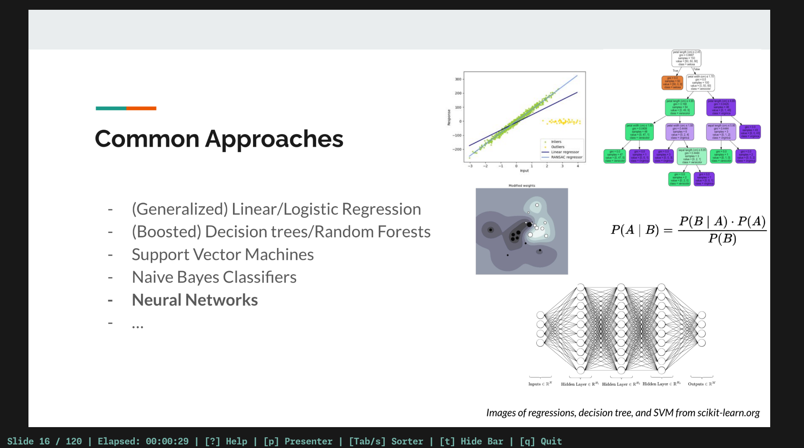
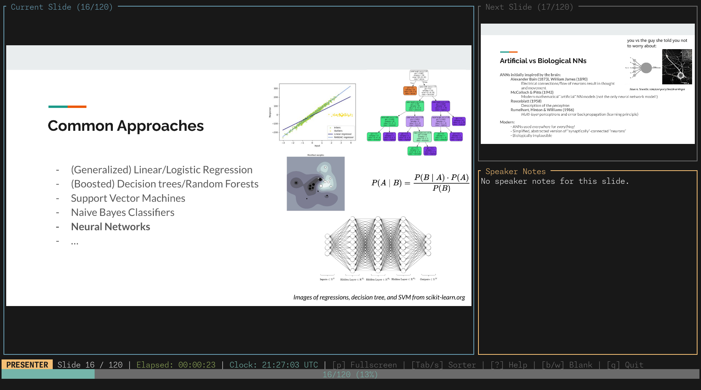
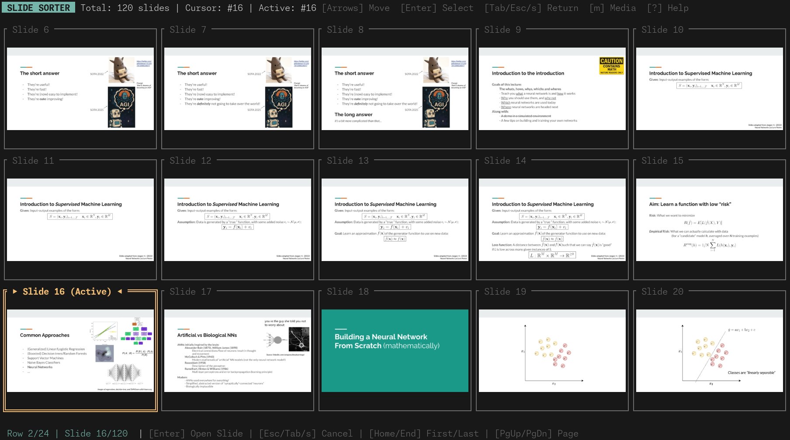

# kitty-pptx

> High-fidelity terminal presentation viewer and vector export engine for Microsoft PowerPoint (`.pptx`) and PDF documents.

`kitty-pptx` renders presentations and documents directly inside your terminal emulator with GPU-accelerated clarity, powered exclusively by the **Kitty Graphics Protocol**. Built on a resolution-independent vector engine, it provides pixel-perfect slide presentation, interactive presenter tools, visual slide sorting, and headless SVG/PNG export.

---

## Previews

### Fullscreen Presentation View
*Clean, full-bleed slide rendering centered with automatic aspect ratio compensation.*



### Presenter Console
*Dual-pane console featuring current slide, next slide preview thumbnail, speaker notes, elapsed presentation timer, and progress gauge (`p` key).*



### Visual Slide Sorter
*Interactive 2D thumbnail grid for visual navigation across the entire deck (`Tab` or `s` key).*



---

## What to Expect

- **Native Terminal Presentation**: Present `.pptx` slide decks and PDF documents directly from the command line without opening a heavy office suite.
- **Hardware-Accelerated Terminal Graphics**: Uses the Kitty Graphics Protocol with PNG transmission and direct cursor placement for full-resolution slides.
- **Kitty-Only Display**: Startup fails with a clear error when the terminal does not implement the Kitty graphics protocol. There is no Sixel, iTerm2, or half-block fallback.
- **Interactive TUI Presenter**:
  - **Normal View**: Clean, full-bleed slide rendering centered with automatic aspect ratio compensation (16:9, 4:3, widescreen).
  - **Presenter View**: Dual-pane console featuring current slide, next slide preview thumbnail, speaker notes, elapsed presentation timer, and progress gauge.
  - **Slide Sorter**: Visual 2D thumbnail grid (`Tab` or `s`) with instant slide navigation.
  - **Document Reader Mode**: Multi-page side-by-side spread and continuous scroll modes optimized for documents.
- **Headless Vector & Raster Export**: Batch export presentations to standalone SVG (with selectable text or converted glyph outlines) and high-resolution PNG at custom DPI.
- **Resolution-Independent Vector Pipeline**: Presentation shapes, gradients, and typography compile to an intermediate vector display list (`VectorSlide`) before rasterization, ensuring crisp rendering at any terminal size or display scale.

---

## Installation

### Prerequisites

- **Rust**: Version 1.75 or later with Cargo ([rustup.rs](https://rustup.rs/))
- **Terminal Emulator**: A terminal implementing the Kitty graphics protocol (Kitty, Ghostty, WezTerm, or an Alacritty fork with Kitty graphics support).

### Building from Source

```bash
# Clone the repository
git clone https://github.com/your-org/kitty-pptx.git
cd kitty-pptx

# Build the release binary
cargo build --release

# The compiled binary will be located at:
# target/release/kitty-pptx
```

### Installing Locally

Install the binary directly into your Cargo binary directory (`~/.cargo/bin`):

```bash
cargo install --path crates/kitty-pptx-cli
```

Verify the installation:

```bash
kitty-pptx --version
kitty-pptx --help
```

---

## Quick Start

### 1. Interactive Presentation (TUI)

Launch the interactive presenter:

```bash
kitty-pptx presentation.pptx
```

Press `p` to toggle **Presenter View** with speaker notes and a next-slide preview, or `?` to display the keyboard shortcuts modal.

### 2. View a Specific Slide

Render a single slide to the terminal and exit:

```bash
# View slide 3
kitty-pptx view presentation.pptx --slide 3

# View all slides in sequence
kitty-pptx view presentation.pptx --all
```

### 3. Batch Export to SVG or PNG

Export presentation slides without a terminal interface:

```bash
# Export all slides to standalone SVGs
kitty-pptx export presentation.pptx --format svg -o ./output/

# Export slides 1 through 5 to high-resolution PNGs at 300 DPI
kitty-pptx export presentation.pptx --format png --dpi 300 --slides 1-5 -o ./output/
```

### 4. Inspect Presentation Structure & Speaker Notes

Extract metadata, slide dimensions, and speaker notes:

```bash
# Display presentation metadata and slide count
kitty-pptx info presentation.pptx

# Dump speaker notes formatted as Markdown
kitty-pptx dump presentation.pptx --notes --markdown

# Dump slide hierarchy as JSON
kitty-pptx dump presentation.pptx --json
```

---

## Interactive TUI Controls

| Key | Action |
| :--- | :--- |
| `Space` / `Enter` / `Right` / `Down` / `PageDown` / `n` / `j` | Next slide |
| `Backspace` / `Left` / `Up` / `PageUp` / `p` / `k` | Previous slide |
| `[number]` followed by `Enter` | Jump directly to slide number |
| `g` | Jump to first slide |
| `G` | Jump to last slide |
| `p` | Toggle **Presenter Mode** (split view with notes, preview & timer) |
| `Tab` / `s` | Toggle **Slide Sorter** (interactive 2D thumbnail grid) |
| `/` | Open Table of Contents / fuzzy search modal |
| `t` | Toggle minimal status line in normal view |
| `b` | Blank screen (black pause screen) |
| `w` | White screen (white pause screen) |
| `?` / `h` | Toggle keyboard shortcuts help overlay |
| `q` / `Esc` / `Ctrl+C` | Exit presenter |

---

## Architecture Overview

`kitty-pptx` employs a **two-stage vectorized rendering pipeline** designed for fidelity, speed, and resolution independence:

```
┌─────────────────────────────────┐
│     PowerPoint File (.pptx)     │
└────────────────┬────────────────┘
                 │
                 ▼
┌─────────────────────────────────┐
│   OOXML Parser & Data Model     │
│  (pptx-parser / pptx-model)     │
└────────────────┬────────────────┘
                 │
                 ▼
┌─────────────────────────────────┐
│    Stage 1: Slide Compiler      │
│  - Parametric Geometry Engine   │
│  - Typography & Text Layout     │
│  - Inset Strokes & Gradients    │
└────────────────┬────────────────┘
                 │ VectorSlide IR
        ┌────────┴────────┐
        ▼                 ▼
┌──────────────┐   ┌──────────────┐
│ Stage 2:     │   │ Stage 2:     │
│ tiny-skia    │   │ SVG Exporter │
│ Rasterizer   │   │ (Vector XML) │
└───────┬──────┘   └──────────────┘
        │ RGBA Framebuffer
        ▼
┌─────────────────────────────────┐
│     Terminal Graphics Driver    │
│  - Kitty graphics protocol      │
│  - PNG transmission             │
│  - Direct cell placement        │
└─────────────────────────────────┘
```

### Workspace Crates

- **`kitty-pptx-cli`**: Command-line interface, configuration loading, and subcommand routing.
- **`kitty-pptx-core`**: Core engine containing the `VectorSlide` intermediate representation, shape compilers, `tiny-skia` rasterizer, and SVG serializer.
- **`kitty-pptx-display`**: Kitty graphics driver, capability probe, and cell aspect ratio mapper.
- **`kitty-pptx-tui`**: Ratatui presentation application, dual-mode layout widgets, keyboard handler, and speaker notes display.
- **`pptx-parser` & `pptx-model`**: Upstream OOXML PowerPoint DOM parser and data model (vendored for build reproducibility).

---

## Configuration

`kitty-pptx` supports optional configuration via `kitty-pptx.toml` (searched in `./kitty-pptx.toml` or `~/.config/kitty-pptx/config.toml`):

```toml
# Default presentation view ('normal' or 'presenter')
mode = "normal"

# Default DPI for PNG exports
export_dpi = 192

# Show minimal status bar in normal view
status_bar = true
```

---

## Development & Testing

Run workspace checks and test suites:

```bash
# Check compilation across all crates
cargo check --workspace

# Run the complete test suite (1,100+ tests)
cargo test --workspace

# Enforce strict source file size limit (< 600 lines)
find crates/kitty-pptx-* -name "*.rs" | xargs wc -l | sort -nr
```

For developer conventions, coordinate math (EMUs), and architectural guidelines, see [`AGENTS.md`](./AGENTS.md).

---

## License

This project is licensed under the [MIT License](./LICENSE).

### Upstream Components

Vendored and upstream parser crates (`pptx-parser`, `pptx-model`, `ooxml-common`) carry their own upstream licenses and copyright notices from their respective authors, as documented in [`crates/VENDORED.md`](./crates/VENDORED.md).
