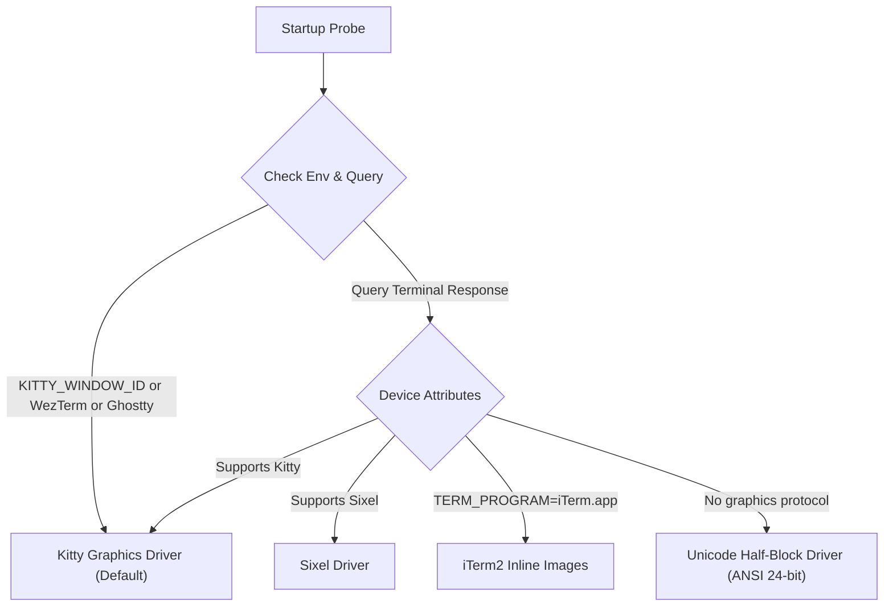

# PRD 03: Terminal Graphics Protocol & Display Adapter

## 1. Overview
The Terminal Graphics Protocol Adapter bridges the rasterized RGBA slide pixmap with the terminal window. Its primary driver implements the **Kitty Graphics Protocol** (supported natively by Kitty, Ghostty, and WezTerm), while abstracting the output interface so alternative protocols (Sixel, iTerm2, Unicode half-blocks) can be used as fallbacks.

---

## 2. The Kitty Graphics Protocol Specification

The Kitty Graphics Protocol transmits image data over the terminal TTY using base64-encoded escape sequences.

### 2.1 Escape Sequence Syntax
```
<ESC>_G<control_keys>;<payload><ESC>\
```
Where:
- `<ESC>` is ASCII byte `0x1B`.
- `_G` indicates graphics command initiation.
- `<control_keys>` is a comma-separated list of key-value pairs (e.g. `a=T,f=100,i=42`).
- `;` separates metadata from payload.
- `<payload>` is base64-encoded image data.
- `<ESC>\` (or ASCII `0x07` BEL) terminates the sequence.

### 2.2 Essential Control Keys
| Key | Name | Values / Meaning |
| :--- | :--- | :--- |
| `a` | Action | `T` (Transmit & display), `t` (Transmit only), `p` (Display existing), `d` (Delete) |
| `f` | Format | `100` (PNG), `32` (32-bit RGBA raw), `24` (24-bit RGB raw) |
| `s`, `v` | Source Dimensions | Source image pixel width (`s`) and height (`v`) |
| `c`, `r` | Display Size | Target size in terminal cells: columns (`c`) and rows (`r`) |
| `i` | Image ID | 32-bit unsigned integer to identify the image in terminal memory |
| `m` | More Chunks | `1` (More chunks follow), `0` (Final chunk) |
| `q` | Quietness | `1` (Suppress OK confirmations), `2` (Suppress all responses) |

### 2.3 Chunking Protocol
Kitty limits any single escape sequence payload to **4096 bytes** of base64 text:
1. Base64-encode the raw RGBA or PNG bytes.
2. Slice into chunks of up to 4096 bytes.
3. Transmit the first chunk with `m=1` and all header keys (`a=T,f=100,i=1,c=80,r=24,m=1;...`).
4. Transmit intermediate chunks with `m=1` (`\x1b_Gm=1;<chunk>\x1b\`).
5. Transmit the final chunk with `m=0` (`\x1b_Gm=0;<chunk>\x1b\`).

---

## 3. Terminal Geometry & Aspect Ratio Fitting

Slides must be rendered and positioned without stretching, blurring, or aspect ratio distortion.

```
┌────────────────────────────────────────────────────────────────┐
│ Terminal Window (Total cols: 120, Total rows: 40)              │
│                                                                │
│        ┌──────────────────────────────────────────────┐        │
│        │                                              │        │
│        │          Rendered Slide (16:9)               │        │
│        │          Display: 106 cols x 30 rows         │        │
│        │                                              │        │
│        └──────────────────────────────────────────────┘        │
│                                                                │
│ [Status Bar: Slide 3/20 | 00:04:12 | Notes: Present]           │
└────────────────────────────────────────────────────────────────┘
```

### 3.1 Pixel-to-Cell Geometry Discovery
The adapter queries the terminal window pixel dimensions using the standard Unix `ioctl` call:
```rust
#[repr(C)]
struct WinSize {
    ws_row: u16,
    ws_col: u16,
    ws_xpixel: u16,
    ws_ypixel: u16,
}
```
From `WinSize`:
$$\text{cell\_width} = \frac{\text{ws\_xpixel}}{\text{ws\_col}}, \quad \text{cell\_height} = \frac{\text{ws\_ypixel}}{\text{ws\_row}}$$

If `ws_xpixel` is 0 (some multiplexers do not report pixels), the engine assumes a standard $1:2$ font aspect ratio ($\approx 10\text{ px} \times 20\text{ px}$).

### 3.2 Fitting Modes
- **`Contain` (Default)**: Fits the entire slide within available terminal cells while preserving aspect ratio ($16:9$ or $4:3$), centering the slide horizontally and vertically with letterboxing.
- **`FillWidth`**: Scales slide width to match 100% of available terminal columns.
- **`ActualPixels`**: Renders 1:1 pixel mapping for 4K / high-DPI terminal configurations.

---

## 4. Terminal Memory Management & Flicker-Free Transitions

Terminal emulators allocate internal GPU/RAM buffers for transmitted images. Failing to clean up will exhaust terminal memory during long presentations.

### 4.1 Image ID Recycling Strategy
- The viewer allocates two dedicated Image IDs: `IMAGE_ID_PRIMARY = 1` and `IMAGE_ID_SECONDARY = 2`.
- When transitioning from Slide A to Slide B:
  1. Transmit Slide B to `IMAGE_ID_SECONDARY` using action `a=t` (Transmit without displaying).
  2. Emit action `a=p,i=2` (Instantly display secondary image over primary).
  3. Emit action `a=d,d=i,i=1` (Delete old primary image from terminal memory).
  4. Swap active IDs for the next transition.
- **Benefit**: Completely eliminates display flicker and guarantees the terminal holds at most two slide images in GPU memory at any time.

### 4.2 Cleanup on Exit
On application shutdown or `SIGINT`, the driver emits:
```
\x1b_Ga=d,d=A\x1b\
```
(Deletes all images created by the process and clears cursor positioning).

---

## 5. Terminal Capability Detection & Fallback Hierarchy

`kitty-pptx` probes the terminal environment on startup:



### 5.1 Protocol Abstraction Trait
```rust
pub trait TerminalGraphicsDriver: Send + Sync {
    /// Human-readable protocol name (e.g. "Kitty", "Sixel")
    fn name(&self) -> &'static str;
    
    /// Display an in-memory pixmap at specific cell coordinates
    fn render(
        &mut self,
        pixmap: &tiny_skia::Pixmap,
        rect: CellRect,
        image_id: u32,
    ) -> Result<(), DisplayError>;
    
    /// Clean up image resources
    fn clear(&mut self, image_id: u32) -> Result<(), DisplayError>;
}
```

### 5.2 Fallback Implementations
1. **Kitty Driver**: First-class, zero-latency, full 32-bit RGBA transparency support.
2. **Sixel Driver**: Converts `tiny-skia` RGBA pixmap to 256-color palette Sixel bands. Supports `xterm`, `foot`, `mlterm`.
3. **iTerm2 Driver**: Encodes pixmap to inline PNG using `\x1b]1337;File=inline=1:...^\x07`.
4. **Unicode Half-Block (`▀`)**: Fallback for any terminal supporting 24-bit truecolor. Uses upper/lower character halves (`U+2580`) with foreground and background ANSI escape sequences.
