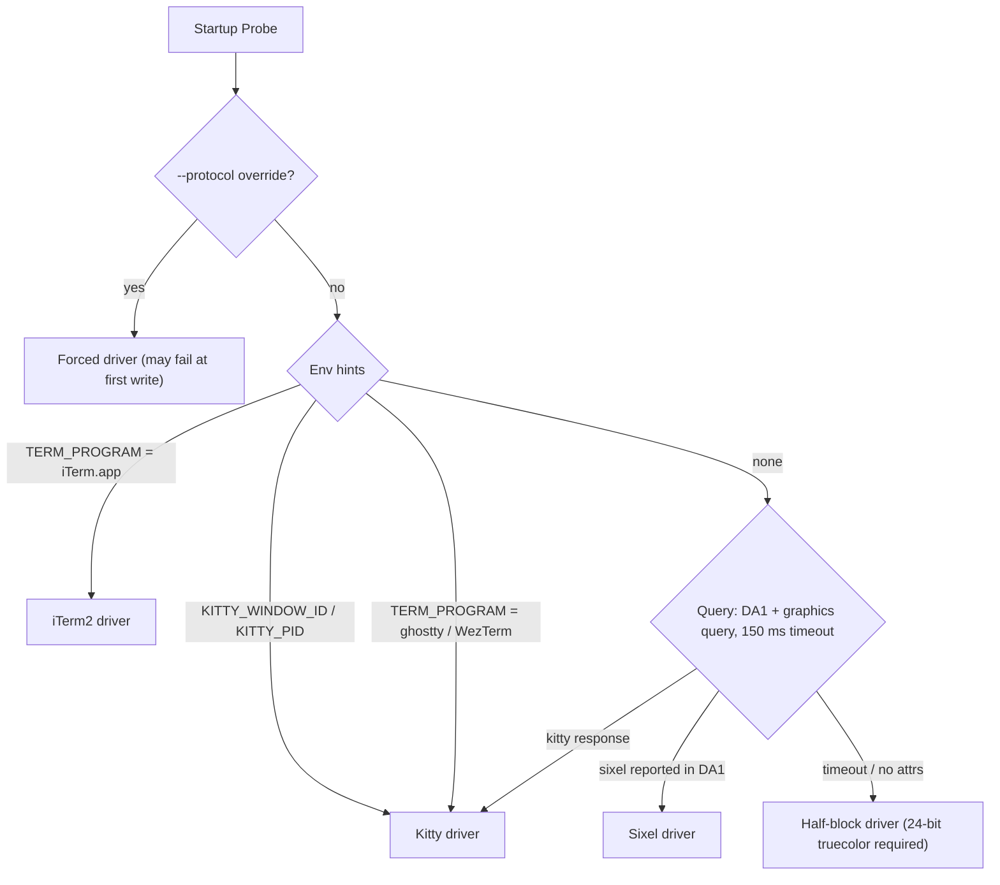

# PRD 03: Terminal Graphics Protocol & Display Adapter

## 1. Overview

The Display Adapter (blocks B13–B16) bridges composited frames ([PRD 02a](./02a-composition-core-and-render-pipeline.md)) to the terminal window. Its primary driver implements the **Kitty Graphics Protocol** (Kitty, Ghostty, WezTerm); Sixel, iTerm2, and Unicode half-blocks are structured fallbacks behind one trait.

**Architectural rule**: the display layer consumes `RgbaSlide` — the renderer-agnostic frame contract of [PRD 06](./06-component-interface-contracts.md) §2. **No rasterizer types (`tiny-skia` etc.) appear in this layer.** The adapter never interprets slide content; it places pixels.

## 2. The Kitty Graphics Protocol

### 2.1 Escape Sequence Syntax
```
<ESC>_G<control_keys>;<payload><ESC>\
```
`<ESC>` = `0x1B`; `_G` initiates a graphics command; control keys are comma-separated `key=value` pairs; `;` separates keys from the base64 payload; the sequence terminates with `<ESC>\` (ST) or `0x07` (BEL).

### 2.2 Control Keys Used

| Key | Name | Values / Meaning |
| :--- | :--- | :--- |
| `a` | Action | `T` (transmit & display), `t` (transmit only), `p` (display already-transmitted image), `d` (delete) |
| `f` | Format | `100` (PNG), `32` (32-bit RGBA raw), `24` (24-bit RGB raw) |
| `s`, `v` | Source dims | Source pixel width / height (required for raw formats) |
| `c`, `r` | Display size | Target size in terminal **cells** (columns / rows) — the terminal scales the image to this area |
| `i` | Image ID | 32-bit unsigned id identifying the image in terminal memory |
| `I` | Image number | Alternative id namespace (not used by this design) |
| `m` | More chunks | `1` (more chunks follow), `0` (final chunk) |
| `U` | Unicode placeholders | `1` — image is placed via placeholder characters that flow with text (required for scrollback persistence, §7) |
| `q` | Quietness | `1` (suppress OK confirmations), `2` (suppress all responses) |
| `z` | Compression | zlib compression of payload (raw formats only) |

### 2.3 Chunking
A single escape sequence payload is capped at **4096 bytes of base64 text**:

1. Encode the frame (PNG or raw RGBA per §3).
2. Slice into ≤ 4096-byte chunks.
3. First chunk carries the full header with `m=1` (`a=t,f=100,i=<id>,s=1920,v=1080,m=1;<chunk>`).
4. Intermediate chunks: `\x1b_Gm=1;<chunk>\x1b\`.
5. Final chunk: `\x1b_Gm=0;<chunk>\x1b\`.

## 3. Adaptive Payload Format

Transmit cost = (encode CPU) + (tty bytes). The two supported formats trade these oppositely:

| Format | Encode cost (1080p) | Payload size (1080p) | Wins when |
| :--- | :--- | :--- | :--- |
| PNG (`f=100`) | ~30–80 ms | ~0.5–2 MB | Any constrained link; **default** — encoding happens in pipeline idle time (02a §5.2), never at flip time |
| Raw RGBA (`f=32`, +`z`) | ~0 (zlib optional) | ~8.3 MB raw / ~3–6 MB zlib'd | Fast local ttys where CPU encode is the bottleneck |

Policy: **PNG by default**; `--payload raw` / `[display] payload = "raw"` override; raw automatically implies `z=4` unless disabled. A frame is encoded exactly once per staging (never per display).

## 4. Terminal Geometry & Aspect Ratio Fitting

### 4.1 Pixel-to-Cell Geometry Discovery
Query window pixel dimensions via the standard `ioctl(TIOCGWINSZ)`:

```rust
#[repr(C)]
struct WinSize { ws_row: u16, ws_col: u16, ws_xpixel: u16, ws_ypixel: u16 }
```

$$\text{cell\_w} = \frac{\text{ws\_xpixel}}{\text{ws\_col}},\qquad \text{cell\_h} = \frac{\text{ws\_ypixel}}{\text{ws\_row}}$$

If `ws_xpixel` is `0` (multiplexers, virtual ptys, and some SSH setups):
1. **Active Query Fallback**: The driver immediately sends an ANSI window/cell size query:
   - `CSI 16 t` (`\x1b[16t`): Requests cell size in pixels, answered as `\x1b[6;<h>;<w>t`.
   - `CSI 14 t` (`\x1b[14t`): Requests window size in pixels, answered as `\x1b[4;<h>;<w>t`.
   A quick 50 ms non-blocking read resolves the exact pixel dimensions.
2. **Heuristic Fallback**: If the query times out or is unsupported, assume a standard $10 \times 20$ px cell (2:1 aspect ratio) and mark geometry as *estimated* — placement recomputes cleanly when real pixel data is received.

### 4.2 Fitting Modes & Client-Side Scaling
The adapter transmits frames at the pipeline's render resolution (default 1920×1080) and **lets the terminal scale** by specifying display size in cells (`c`/`r`) — the terminal scales the resident image to the cell area:

- **`Contain` (default)**: largest cell rect preserving slide aspect, centered; surrounding cells letterbox (status bar area owned by the TUI).
- **`FillWidth`**: full terminal width, height by aspect.
- **`ActualPixels`**: no `c`/`r` — 1:1 pixels (pipeline target switches to native pixel dims; 02a §5.3 `TargetChanged`).

Consequence: **resize does not re-transmit or re-rasterize** — the adapter re-issues only the display action with new `c`/`r`, and the terminal rescales its resident image.

### 4.3 Terminal Multiplexer Support (`tmux`, `zellij`)
When running inside a terminal multiplexer (detected via `$TMUX` or `$ZELLIJ`):
1. **`tmux` DCS Pass-Through**: By default, `tmux` drops unhandled OSC/graphics escapes. To pass sequences through to the outer terminal:
   - Every escape byte `\x1b` within the sequence is doubled (`\x1b\x1b`).
   - The sequence is wrapped in a Device Control String (DCS) pass-through envelope:
     ```
     \x1bPtmux;\x1b<escaped_graphics_command>\x1b\\
     ```
   - *Requirement*: `tmux` must have `set -g allow-passthrough on` in `tmux.conf` (a helpful diagnostic warning is emitted if passthrough fails).
2. **`zellij`**: Newer Zellij versions support Kitty/Sixel passthrough directly without DCS wrapping.

## 5. Image Lifecycle & Pre-Transmission

### 5.1 The Latency Contract
Flip latency target is < 16 ms from keypress to `present()` written ([PRD 00](./00-system-overview.md) §5). Transmitting megabytes at flip time cannot meet it. The lifecycle is therefore split:

| Operation | Kitty action | When | Cost |
| :--- | :--- | :--- | :--- |
| `stage(id, bmp)` | `a=t` (transmit only) | Pipeline idle time, off UI thread (02a §5.2) | Encode + tty transfer (amortized) |
| `present(id, placement)` | `a=p, i=id, c=…, r=…` | Flip time | One escape sequence — O(1) |
| `reposition(id, placement)` | `a=p` with new `c`/`r` | Resize | O(1) |
| `release(id)` | `a=d, d=i, i=id` | Eviction from pipeline window | O(1) |
| `release_all()` | `a=d, d=a` | Exit (§9) | O(1) |

> **Correction from the previous revision**: cleanup-on-exit was specified as `\x1b_Ga=d,d=A\x1b\`. The delete-all value is lowercase: `d=a`. (`d=I`/`d=N` uppercase forms exist for *number/name* targeting, not "all".)

### 5.2 Image ID Pool
- Pool of **8 ids** (1–8), LRU-managed by the pipeline via `StageSink` ([PRD 06](./06-component-interface-contracts.md) §6).
- `stage` on an existing id **replaces** that image atomically (idempotent re-staging is safe).
- Invariant: the terminal holds at most 8 resident images from this process; eviction releases the id *before* the slot is reused.

### 5.3 Flicker-Free Transitions
Slides A → B: B is already staged at `id_B` (idle-time prefetch). Flip = `present(id_B, …)`; the pipeline then releases `id_A` once B+1's staging needs the slot. At no point is the screen without the current slide — no blank-frame window exists.

## 6. Driver Abstraction

```rust
pub trait TerminalGraphicsDriver: Send {
    fn name(&self) -> &'static str;
    fn caps(&self) -> DriverCaps;                      // alpha, placeholders, scaling, max_ids
    fn stage(&mut self, bmp: &RgbaSlide, id: ImageId) -> Result<(), DisplayError>;
    fn present(&mut self, id: ImageId, p: Placement) -> Result<(), DisplayError>;
    fn reposition(&mut self, id: ImageId, p: Placement) -> Result<(), DisplayError>;
    fn release(&mut self, id: ImageId) -> Result<(), DisplayError>;
    fn release_all(&mut self) -> Result<(), DisplayError>;
    fn placement_mode(&self) -> PlacementMode;          // Interactive | Scrollback
}
```

Behavioral contract (normative, PRD 06 §6): `present`/`reposition` on an unstaged id → `DisplayError::NotStaged`; `stage` is idempotent-replace; every byte funnels through the single `TtyWriter`; no call blocks beyond the current chunk write.

## 7. Placement Modes

### 7.1 Interactive (TUI)
Alternate-screen presentation ([PRD 04](./04-interactive-tui-presenter.md)). The TUI layout allocates a `CellRect` for the slide canvas. Two display methods are supported:

1. **Unicode Placeholder Grid (`U=1`) — Preferred for Ratatui**:
   - The slide frame is transmitted with `a=t,U=1,i=<id>`.
   - The TUI's custom Ratatui slide widget fills the target canvas cells in Ratatui's internal `Buffer` with Kitty placeholder characters (`U+10EEEE`), using foreground and background colors to encode the Image ID and cell row/col offsets.
   - **Why this is superior**: Ratatui's standard cell-diffing engine writes the placeholder cells normally. Overlapping UI elements (help modals `?`, warning drawers `w`, status bars) seamlessly overwrite the image without cell-clearing race conditions or cursor positioning hacks!
2. **Direct Placement (`a=p`) — Fallback**:
   - If Unicode placeholders are disabled, the driver emits a cursor positioning sequence (`CUP`) to `(rect.row, rect.col)` followed by `\x1b_Ga=p,i=<id>,c=<cols>,r=<rows>\x1b\`. Ratatui's buffer leaves the slide area blank.

### 7.2 Scrollback (`view` subcommand)
The one-shot pager ([PRD 05](./05-cli-and-export.md) §2.2) prints slides into the terminal **scrollback buffer**. Plain cursor-positioned images do **not** survive scrolling; scrollback placement therefore uses **Unicode placeholders** (`U=1`):

1. Transmit the frame with `a=t, U=1` and its intended cell size.
2. The driver emits the returned placeholder character sequence padded to `c × r` cells (the terminal replaces the placeholder area with the image, and the image flows with the text when scrolled).
3. Each slide occupies its own placeholder block; a text header line (slide number + title) precedes it.

If the selected driver lacks placeholder support (`DriverCaps.placeholders == false`), `view` falls back to one-image-per-screen paging with a keypress between slides. Scrollback mode is **Kitty-protocol only** in v1 (capability-gated).

## 8. Capability Detection & Fallback Hierarchy



Probe rules:
- Environment variables are **hints, not proofs**; the graphics query response is authoritative when obtained.
- Probe writes/reads carry a **150 ms timeout**; on timeout the probe result is discarded and the next tier is tried. A wedged query never hangs startup.
- If the final tier (half-block) is unavailable (no 24-bit color), `view`/TUI exit with code 3 ([PRD 05](./05-cli-and-export.md) §5); `dump`/`export` are unaffected (they never open a driver).

### 8.1 Fallback Driver Specifications

| Driver | Terminals | Encoding contract | Degradations |
| :--- | :--- | :--- | :--- |
| **Kitty** | kitty, Ghostty, WezTerm | §2–§7 full protocol; PNG/raw adaptive | none (reference driver) |
| **Sixel** | foot, xterm (`-ti 340`), mlterm, newer Windows Terminal | Median-cut quantization to ≤ 256 colors; 16-band interlaced emission; dithering off (slides are flat-color art) | No alpha: straight-alpha composited over black + optional configured bg; no placeholders → `view` pages; no image-id reuse → re-emit on present (stage = cache only) |
| **iTerm2** | iTerm2, WezTerm (`TERM_PROGRAM=iTerm.app`) | `\x1b]1337;File=inline=1;width=<cols>;height=<rows>:;<base64>\x07` (PNG only; BEL terminator) | `stage` caches encoded PNG; `present` re-emits (no terminal-side image registry) |
| **Half-block** | any 24-bit truecolor terminal | `▀` (U+2580) upper/lower halves; fg = upper px, bg = lower px; box-filter downscale to cell grid; alpha over terminal default bg | ~½ cell resolution; no staging (present renders directly); used as last resort |

## 9. Cleanup Contract

On **any** exit path — normal quit, `SIGINT`/`SIGTERM`, or panic hook:

1. `release_all()` (`\x1b_Ga=d,d=a\x1b\` for the Kitty driver).
2. Leave alternate screen, restore cursor visibility and canonical mode ([PRD 04](./04-interactive-tui-presenter.md) §5).
3. Never emit a partial escape sequence on exit (the TtyWriter flushes or discards atomically).

## 10. Failure Semantics

| Failure | Detection | Behavior |
| :--- | :--- | :--- |
| stdout not a TTY (graphics mode) | `isatty(1)` | Exit code 3 before any escape emission (graphics subcommands require a TTY; `dump`/`export` exempt) |
| Write error / `EPIPE` | Any driver write | `DisplayError::Io`; TUI shows status message and continues in half-block degraded mode if available, else exits 3 |
| Terminal ignores graphics query | Probe timeout (§8) | Fall through hierarchy |
| Corrupt/absent query response | Parse error | Treated as unsupported; fall through |
| Image too large for terminal quota | Kitty error response (`q` unset on staging in debug mode) | `DisplayError::QuotaExceeded` → pipeline lowers staged window (e.g. 8 → 4 ids) and retries once |
