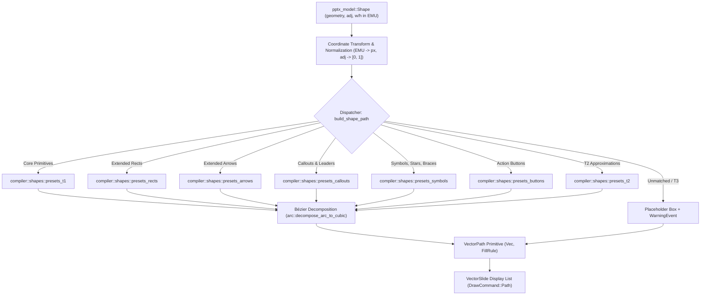

# PRD 11: Extended & Tier 3 Shape Presets (Obscure Presets & Extended Geometry Library)

> **Normative Architectural Specification & Product Requirements Document**  
> **Status**: Approved · **Applies to**: `office-terminal-core::compiler::shapes`  
> **Companion Documents**: [PRD 02b](./02b-vector-style-and-geometry-engine.md), [PRD 02b Appendix](./02b-appendix-preset-geometries.md), [PRD 02d](./02d-element-renderers-and-fidelity-policy.md), [PRD 06](./06-component-interface-contracts.md), [PRD 07](./07-quality-and-testing.md)

---

## 1. Executive Summary & Preset Coverage Strategy

### 1.1 Problem Statement & Strategic Rationale
The ECMA-376 DrawingML standard defines **187 standard preset shape geometries** (`ST_ShapeType`, ECMA-376 Part 1, §20.1.10.55). In earlier revisions of `kitty-pptx` ([PRD 02b Appendix](./02b-appendix-preset-geometries.md)), only 25 high-frequency primitives were classified as **Tier 1 (FULL Parametric)**, while 13 shapes were handled as **Tier 2 (DEGRADED Stand-Ins)**. The remaining ~150 shapes fell into **Tier 3 (PLACEHOLDER)**, rendering generic labeled fallback rectangles and emitting `WarningEvent::UnsupportedPreset`.

In real-world business, technical, and educational decks, slides frequently incorporate shapes outside the basic 25:
- **Process & Architecture Flows**: Bent arrows, U-turn arrows, notched arrows, 4-way quad arrows, and segmented connectors.
- **Speech, Commentary & Notes**: Multi-directional wedge callouts, rounded balloons, cloud thought balloons, and annotated leader lines with drop shoulders (`lineCallout1`–`lineCallout4`).
- **UI Mockups & Interactive Decks**: Action buttons (`actionButtonBackPrevious`, `actionButtonForwardNext`, `actionButtonHome`, `actionButtonHelp`, etc.) combining beveled 3D button casings with standard interior vector glyph icons.
- **Card, Layout & Content Containers**: Snipped-corner rectangles (`snip1Rect`, `snip2SameRect`, `snip2DiagRect`, `snipRoundRect`) and rounded-corner variants (`round1Rect`, `round2SameRect`, `round2DiagRect`).
- **Grouping & Annotations**: Brackets, curly braces (`leftBrace`, `rightBrace`, `bracePair`), half-frames, and diagonal stripes.
- **Badges, Ratings & Accents**: Multi-pointed star seals (`star4` through `star32`), plaques, teardrops, funnels, and mechanical gears (`gear6`, `gear9`).

Treating these shapes as placeholders severely degrades presentation fidelity. This document establishes the definitive specification to systematically promote high-utility shapes into fully parametric (Tier 1) and robust geometric stand-in (Tier 2) implementations, leaving only truly ambiguous or vendor-proprietary legacy objects as Tier 3 fallbacks.

```
                      ECMA-376 PRESET COVERAGE EXPANSION
  ┌────────────────────────────────────────────────────────────────────────┐
  │ Total DrawingML Presets: 187 Shapes                                    │
  ├────────────────────────────────────────────────────────────────────────┤
  │ Previous: [Tier 1: 25 Shapes]  │ [Tier 2: 13 Shapes] │ [Tier 3: 149]   │
  ├────────────────────────────────────────────────────────────────────────┤
  │ PRD 11:   [Tier 1: 92 Shapes]  │ [Tier 2: 68 Shapes] │ [Tier 3: 27]    │
  │           Exact Parametric     │ Geometric Stand-Ins │ Fallback Bounds │
  │           & Dynamic Handles    │ Canonical Silhouettes│ & Diagnostics  │
  └────────────────────────────────┴─────────────────────┴─────────────────┘
```

---

### 1.2 Preset Fidelity Classification Policy

Every preset geometry maps deterministically to one of three fidelity tiers:

| Tier | Designation | Criteria | Rendering Guarantee | Diagnostic Emission |
| :--- | :--- | :--- | :--- | :--- |
| **Tier 1** | **FULL (Parametric)** | Path constructed via exact analytic closed-form equations or exact cubic Bézier approximations matching ECMA-376 guide formulas. Dynamically honors DrawingML adjustment handles (`adj1`–`adj8`). | Identical silhouette to reference PPTX engines at arbitrary DPI/scaling. Text bounds accurately bounded. | None. Pure vector path output. |
| **Tier 2** | **DEGRADED (Stand-In)** | Complex 3D extrusions, folded ribbons, or decorative infographics represented as 2D planar vector silhouettes that preserve bounding dimensions, dominant contours, and visual semantics. | Recognizable aesthetic stand-in. No text clipping. Preserves presentation clarity. | None or informational trace. |
| **Tier 3** | **PLACEHOLDER (Fallback)** | Obsolete, undefined, vendor-private, or purely non-geometric legacy presets. | Bounding box with faint dashed border `#404040`, centered label `[Shape: <name>]`. | Emits `WarningEvent::UnsupportedPreset { name }`. |

---

### 1.3 Architectural Pipeline Integration

Shape compilation executes inside `office-terminal-core::compiler::shapes` as a pure, stateless vector generator. It accepts local pixel dimensions $(w, h)$ and raw adjustment values, producing a resolution-independent `VectorPath`:



---

## 2. Complete Catalog & Parametric Formulation Recipes

All coordinates are constructed in local pixel space $(x, y) \in [0, w] \times [0, h]$ with $w, h > 0$. Adjustment parameters `adj1`..`adj8` are normalized from OOXML units ($0\dots 100,000$) to dimensionless ratios:
$$a_k = \frac{\text{adj}_k}{100000.0}$$
Default values apply when parameters are absent or `None`. The standard Bézier quarter-arc factor is $\kappa = \frac{4}{3}(\sqrt{2} - 1) \approx 0.55228475$.

---

### 2.1 Multi-Corner Rectangles

Multi-corner rectangles provide card designs, badge headers, and customized UI tiles with selective corner clipping (snips) or rounding. The maximum permissible cut or radius is $R_{\max} = \frac{1}{2} \min(w, h)$, with effective offset $d_k = R_{\max} \cdot \text{clamp}(a_k, 0.0, 1.0)$. Default $a_{\text{def}} = 0.16667$ ($\approx 16.67\%$).

```
       snip1Rect                    snip2SameRect                  round2DiagRect
 ┌───────────────────/        /───────────────────/        ╭───────────────────┐
 │                  /         │                   │        │                   │
 │                /           │                   │        │                   │
 └───────────────┘            └───────────────────┘        └───────────────────╯
 (Top-Right Snipped)        (Top-L & Top-R Snipped)       (Top-L & Bot-R Rounded)
```

- **`snip1Rect`** (Single Snip Corner):
  Points: $(0, 0) \to (w - d_1, 0) \to (w, d_1) \to (w, h) \to (0, h) \to \text{Close}$.
- **`snip2SameRect`** (Two Snip Same-Side Corners):
  Top-left cut $d_1$, top-right cut $d_2$ (defaults $d_2 = d_1$).
  Points: $(d_1, 0) \to (w - d_2, 0) \to (w, d_2) \to (w, h) \to (0, h) \to (0, d_1) \to \text{Close}$.
- **`snip2DiagRect`** (Two Snip Diagonal Corners):
  Top-left cut $d_1$, bottom-right cut $d_2$ (defaults $d_2 = d_1$).
  Points: $(d_1, 0) \to (w, 0) \to (w, h - d_2) \to (w - d_2, h) \to (0, h) \to (0, d_1) \to \text{Close}$.
- **`snipRoundRect`** (One Snip, One Round Corner):
  Top-left snip $d_1$, top-right round $r_2$.
  Points: $\text{MoveTo}(d_1, 0) \to \text{LineTo}(w - r_2, 0) \to \text{CubicTo}(w - r_2 + r_2 \kappa, 0, w, r_2 - r_2 \kappa, w, r_2) \to \text{LineTo}(w, h) \to \text{LineTo}(0, h) \to \text{LineTo}(0, d_1) \to \text{Close}$.
- **`round1Rect`** (Single Round Corner):
  Top-right corner radius $r_1$.
  Points: $\text{MoveTo}(0, 0) \to \text{LineTo}(w - r_1, 0) \to \text{CubicTo}(w - r_1 + r_1 \kappa, 0, w, r_1 - r_1 \kappa, w, r_1) \to \text{LineTo}(w, h) \to \text{LineTo}(0, h) \to \text{Close}$.
- **`round2SameRect`** (Two Round Corners Same Side):
  Top-left radius $r_1$, top-right radius $r_2$.
  $\text{MoveTo}(0, r_1) \to \text{CubicTo}(0, r_1 - r_1 \kappa, r_1 - r_1 \kappa, 0, r_1, 0) \to \text{LineTo}(w - r_2, 0) \to \text{CubicTo}(w - r_2 + r_2 \kappa, 0, w, r_2 - r_2 \kappa, w, r_2) \to \text{LineTo}(w, h) \to \text{LineTo}(0, h) \to \text{Close}$.
- **`round2DiagRect`** (Two Round Corners Diagonal):
  Top-left radius $r_1$, bottom-right radius $r_2$.
  $\text{MoveTo}(0, r_1) \to \text{CubicTo}(0, r_1 - r_1 \kappa, r_1 - r_1 \kappa, 0, r_1, 0) \to \text{LineTo}(w, 0) \to \text{LineTo}(w, h - r_2) \to \text{CubicTo}(w, h - r_2 + r_2 \kappa, w - r_2 + r_2 \kappa, h, w - r_2, h) \to \text{LineTo}(0, h) \to \text{Close}$.

---

### 2.2 Callout Shapes & Speech Balloons

Callouts combine a container hull with a directional wedge directed toward target coordinate $(x_t, y_t)$, or open leader lines anchored to external diagram features.
- Target Point: $x_t = w \cdot a_1$, $y_t = h \cdot a_2$ (default $a_1 = -0.2$, $a_2 = 1.3$).
- Wedge Base Center: $t_b = a_3$ (default $0.25$, along attachment edge).
- Wedge Base Half-Width: $w_b = \min(w, h) \cdot \text{clamp}(a_4, 0.05, 0.3)$ (default $0.15 \min(w, h)$).

```
       wedgeRoundRectCallout                    lineCallout2 (Dog-Leg)
   ╭─────────────────────────╮                   ┌──────────────┐
   │    Callout Container    │                   │ Text Box     │
   ╰─────╮             ╭─────╯                   └──────┬───────┘
          \           /                                 │  (Drop Shoulder)
           \         /                                  └───────────────● Target (xt, yt)
            \       /
             ● Target (xt, yt)
```

- **`rectCallout` / `wedgeRectCallout`**:
  For target below ($y_t \ge h$), base points on bottom edge: $x_{b1} = \text{clamp}(w \cdot t_b - w_b, 0.0, w - 2 w_b)$, $x_{b2} = x_{b1} + 2 w_b$.
  Path: $(0, 0) \to (w, 0) \to (w, h) \to (x_{b2}, h) \to (x_t, y_t) \to (x_{b1}, h) \to (0, h) \to \text{Close}$.
  *(Note: If $(x_t, y_t)$ lies outside another quadrant, the base automatically binds to the top, left, or right edge).*
- **`roundRectCallout` / `wedgeRoundRectCallout`**:
  Same as `wedgeRectCallout` with corner radius $r = \min(w, h) \cdot \text{clamp}(a_5, 0.0, 0.25)$ applied to non-interrupted corners.
- **`ellipseCallout` / `wedgeEllipseCallout`**:
  Center $(x_c, y_c) = (w/2, h/2)$, semi-axes $r_x = w/2, r_y = h/2$.
  Transform target to unit circle: $u_t = (x_t - x_c)/r_x, v_t = (y_t - y_c)/r_y, D^2 = u_t^2 + v_t^2$.
  For $D > 1.0$, the unit circle tangent points are:
  $$\begin{pmatrix} u_{1,2} \\ v_{1,2} \end{pmatrix} = \frac{1}{D^2} \begin{pmatrix} u_t \\ v_t \end{pmatrix} \pm \frac{\sqrt{D^2 - 1}}{D^2} \begin{pmatrix} -v_t \\ u_t \end{pmatrix}$$
  Convert to ellipse points $x_k = x_c + r_x u_k, y_k = y_c + r_y v_k$. Major elliptical arc connects $(x_1, y_1)$ to $(x_2, y_2)$ via Bézier decomposition, completed by lines $(x_2, y_2) \to (x_t, y_t) \to (x_1, y_1) \to \text{Close}$.
- **`cloudCallout`**:
  Body hull composed of 8 circular lobes decomposed into cubic Béziers with harmonic radius $R(\theta) = R_0 (1.0 + 0.18 \cos(8\theta))$. Plus 2 trailing detached thought bubbles stepping toward $(x_t, y_t)$ at $65\%$ and $90\%$ distance.
- **`lineCallout1` through `lineCallout4`**:
  - `lineCallout1`: Text frame + single straight leader line from boundary to target $(x_t, y_t)$.
  - `lineCallout2`: Text frame + 2-segment dog-leg leader line with drop shoulder.
  - `lineCallout3`: Text frame + vertical accent bar at text margin + 3-segment stepped leader.
  - `lineCallout4`: Full border box + vertical accent bar + multi-segment leader line.

---

### 2.3 Extended Arrow Geometries

```
       notchedRightArrow                    bentArrow                      uturnArrow
 ┌───────────\                        ┌──────────\                   ╭────────╮
 │            \                       │           \                  │  ╭──╮  │
 ├─╮           \                      │            \                 │  │  │  │
 │ ╰─┐          \                     │   ┌────────╯                 │  │  │  │
 │   │           \                    │   │                          │  │  ▼  ▼
 └───┴───────────/                    └───┘                          └──┴───────
```

- **`notchedRightArrow`**:
  Head length $l_h = w \cdot a_1$ ($a_1=0.5$), shaft half-thickness $s_h = \frac{1}{2} h \cdot a_2$ ($a_2=0.5$), notch depth $d_n = w \cdot a_3$ ($a_3=0.25$).
  Points: $(d_n, h/2) \to (0, h/2 - s_h) \to (w - l_h, h/2 - s_h) \to (w - l_h, 0) \to (w, h/2) \to (w - l_h, h) \to (w - l_h, h/2 + s_h) \to (0, h/2 + s_h) \to \text{Close}$.
- **`curvedRightArrow`**, **`curvedLeftArrow`**, **`curvedUpArrow`**, **`curvedDownArrow`**:
  $90^\circ$ circular quadrant ribbon with inner radius $R_i = w \cdot (1 - a_1)$, outer radius $R_o = w$, and arrowhead barb cap at quadrant exit. Arcs decomposed into $45^\circ$ cubic Béziers via `decompose_arc_to_cubic`.
- **`bentArrow`**:
  $90^\circ$ elbow arrow. Shaft ascends from $(0, h)$ to $(w_s, h)$ up to elbow $(w_s, w_s)$, turns right to $(w - l_h, w_s)$, branching into barb $(w - l_h, 0)$, apex $(w, w_s/2 + l_h/2)$, bottom barb $(w - l_h, w_s + l_h)$, and inner corner $(w - l_h, w_s)$.
- **`uturnArrow`**:
  $180^\circ$ hairpin arrow. Ascends vertically on left, curves through $180^\circ$ semicircle arch ($R_o = w/2, R_i = w/2 - w_s$), descends on right, ending in downward-pointing arrowhead at $(w, h)$.
- **`stripedRightArrow`**:
  Standard `rightArrow` silhouette containing 3 vertical cutout slits through the shaft. Emitted with `FillRule::EvenOdd`.
- **Multi-Directional Arrows**:
  - `quadArrow`: 4-way compass arrow with symmetric arrowheads pointing N, S, E, W from central hub.
  - `leftRightUpArrow`: 3-way T-junction arrow pointing Left, Right, and Up.
  - `leftUpArrow`: 2-way corner arrow pointing Left and Up with shared corner hub.

---

### 2.4 Brackets, Braces & Enclosure Frames

```
       leftBrace                              leftBracket                    halfFrame
    ╭──────╮                                   ┌───────┐                      ┌─────────────┐
    │                                          │                              │  ┌──────────┘
    ╰───╮                                      │                              │  │
    ╭───╯                                      │                              │  │
    │                                          │                              │  │
    ╰──────╯                                   └───────┘                      └──┘
```

- **`leftBrace` & `rightBrace`** (Parametric Smooth Curly Braces):
  Hook radius $r = \min(w, h/4) \cdot a_1$ (default $a_1 = 0.1$). $x_0 = w, x_1 = w - r, x_{\text{mid}} = 0, y_{\text{mid}} = h/2$.
  1. Top Hook: $\text{MoveTo}(x_0, 0) \to \text{CubicTo}(x_0 - r \kappa, 0, x_1, r - r \kappa, x_1, r)$.
  2. Upper Stem: $\text{LineTo}(x_1, y_{\text{mid}} - r)$.
  3. Upper Cusp: $\text{CubicTo}(x_1, y_{\text{mid}} - r + r \kappa, x_{\text{mid}} + r \kappa, y_{\text{mid}}, x_{\text{mid}}, y_{\text{mid}})$.
  4. Lower Cusp: $\text{CubicTo}(x_{\text{mid}} + r \kappa, y_{\text{mid}}, x_1, y_{\text{mid}} + r - r \kappa, x_1, y_{\text{mid}} + r)$.
  5. Lower Stem: $\text{LineTo}(x_1, h - r)$.
  6. Bottom Hook: $\text{CubicTo}(x_1, h - r + r \kappa, x_0 - r \kappa, h, x_0, h)$.
  - `rightBrace`: Horizontally mirrored ($x \mapsto w - x$).
  - `bracePair`: Symmetric combination of `leftBrace` and `rightBrace`.
- **`leftBracket`, `rightBracket`, `bracketPair`**:
  Square bracket enclosure with arm depth $d_a = w \cdot a_1$ ($a_1=0.25$): $(d_a, 0) \to (0, 0) \to (0, h) \to (d_a, h)$.
- **`halfFrame` & `corner`**:
  L-shaped border covering top and left edges: $(0, 0) \to (w, 0) \to (w, h \cdot a_1) \to (w \cdot a_2, h \cdot a_1) \to (w \cdot a_2, h) \to (0, h) \to \text{Close}$.
- **`diagStripe`**:
  Diagonal band slicing across opposite corners with width $w_s = \min(w, h) \cdot a_1$.

---

### 2.5 Extended Seals, Badges & Symbols

#### 2.5.1 Universal Parametric Polar Star Formulation
Generates regular $N$-pointed stars ($N \in \{4, 7, 10, 12, 16, 24, 32\}$):
Center $(x_c, y_c) = (w/2, h/2)$, semi-radii $R_x = w/2, R_y = h/2$, inner radius ratio $a_1 \in [0.0, 1.0]$.
For vertex index $m \in \{0, 1, \dots, 2N - 1\}$:
$$\phi_m = -\frac{\pi}{2} + m \cdot \frac{\pi}{N},\qquad \rho_m = \begin{cases} 1.0 & m \text{ even (outer tip)} \\ a_1 & m \text{ odd (inner valley)} \end{cases}$$
$$x_m = x_c + R_x \cdot \rho_m \cos(\phi_m),\qquad y_m = y_c + R_y \cdot \rho_m \sin(\phi_m)$$

| Preset | $N$ | Default $a_1$ | Tip Step $\Delta \theta$ | Preset | $N$ | Default $a_1$ | Tip Step $\Delta \theta$ |
| :--- | :--- | :--- | :--- | :--- | :--- | :--- | :--- |
| **`star4`** | 4 | $0.38197$ | $90.0^\circ$ | **`star16`** | 16 | $0.75000$ | $22.5^\circ$ |
| **`star7`** | 7 | $0.50000$ | $51.428^\circ$ | **`star24`** | 24 | $0.80000$ | $15.0^\circ$ |
| **`star10`**| 10 | $0.60000$ | $36.0^\circ$ | **`star32`** | 32 | $0.85000$ | $11.25^\circ$ |
| **`star12`**| 12 | $0.70000$ | $30.0^\circ$ | | | | |

- **`teardrop`**: Circular top arc ($R = w/2$) tangent to straight lines meeting at bottom-left corner apex $(0, h)$.
- **`gear6` & `gear9`**: Spur gear with 6 or 9 trapezoidal teeth, pitch circle $R_p$, dedendum $R_d = 0.75 R_o$, and central bore hole $R_{\text{bore}} = 0.30 R_o$ (`FillRule::EvenOdd`).
- **`funnel`**: Inverted trapezoidal hopper top $(w \to w \cdot a_1)$ meeting vertical cylindrical spout down to $y = h$.
- **`plaque` & `plaqueTabs`**: Rectangle with 4 concave circular quarter-arc notches scooped from corners ($r = \min(w, h) \cdot a_1$).

---

### 2.6 Action Buttons

Action buttons compile into a composite two-layer vector structure:
1. **Outer Casing**: Beveled button plate with rounded corners, top-left highlight rim (`#FFFFFF` @ 35% alpha), and bottom-right shadow rim (`#000000` @ 35% alpha).
2. **Interior Vector Glyph**: Scaled inside active inner boundary $[x_0, y_0, x_1, y_1] = [0.25 w, 0.25 h, 0.75 w, 0.75 h]$.

```
 ┌─────────────────────────────────────────────────────────┐
 │ Top-Left Highlight Rim (White @ 35% Alpha)              │
 │   ╭─────────────────────────────────────────────────╮   │
 │   │             ┌─────────────────────┐             │   │
 │   │             │ Interior Icon Glyph │             │   │
 │   │             │ (Back, Home, Help)  │             │   │
 │   │             └─────────────────────┘             │   │
 │   ╰─────────────────────────────────────────────────╯   │
 │ Bottom-Right Shadow Rim (Black @ 35% Alpha)             │
 └─────────────────────────────────────────────────────────┘
```

| Action Button Preset | Interior Vector Glyph Geometry | Coordinate Equations in $[x_0, y_0, x_1, y_1]$ |
| :--- | :--- | :--- |
| **`actionButtonBackPrevious`** | Left triangle ($\blacktriangleleft$) | $(x_1, y_0) \to (x_0, y_{\text{mid}}) \to (x_1, y_1) \to \text{Close}$ |
| **`actionButtonForwardNext`** | Right triangle ($\blacktriangleright$) | $(x_0, y_0) \to (x_1, y_{\text{mid}}) \to (x_0, y_1) \to \text{Close}$ |
| **`actionButtonBeginning`** | Bar + Left triangle ($\mid \blacktriangleleft$) | Bar: $[x_0, y_0, x_0 + 0.15 w_g, y_1]$<br/>Triangle: $(x_1, y_0) \to (x_0 + 0.25 w_g, y_{\text{mid}}) \to (x_1, y_1) \to \text{Close}$ |
| **`actionButtonEnd`** | Right triangle + Bar ($\blacktriangleright \mid$) | Triangle: $(x_0, y_0) \to (x_1 - 0.25 w_g, y_{\text{mid}}) \to (x_0, y_1) \to \text{Close}$<br/>Bar: $[x_1 - 0.15 w_g, y_0, x_1, y_1]$ |
| **`actionButtonHome`** | House silhouette (Roof + Walls + Door) | Roof: $(x_{\text{mid}}, y_0) \to (x_1, y_0 + 0.45 h_g) \to (x_0, y_0 + 0.45 h_g) \to \text{Close}$<br/>Walls: $[x_0 + 0.15 w_g, y_0 + 0.45 h_g, x_1 - 0.15 w_g, y_1]$<br/>Door cutout: $[x_{\text{mid}} - 0.12 w_g, y_1 - 0.30 h_g, x_{\text{mid}} + 0.12 w_g, y_1]$ |
| **`actionButtonHelp`** | Question mark symbol ($?$) | Upper hook arc Bézier from $(x_0 + 0.25 w_g, y_0 + 0.25 h_g)$ to neck $(x_{\text{mid}}, y_0 + 0.55 h_g)$, stem to $0.70 h_g$, circular dot at $(x_{\text{mid}}, y_1 - 0.10 h_g)$ with radius $0.06 w_g$. |
| **`actionButtonInformation`** | Information glyph ($i$) | Dot: Circle at $(x_{\text{mid}}, y_0 + 0.15 h_g)$ radius $0.07 w_g$.<br/>Stem: Vertical serif bar from $y_0 + 0.35 h_g$ to $y_1 - 0.10 h_g$. |
| **`actionButtonMovie`** | Movie slate / camera | Camera box + two top circular reels + projection lens trapezoid $(x_1 - 0.25 w_g, y_{\text{mid}} \pm 0.15 h_g) \to (x_1, y_{\text{top/bot}})$. |
| **`actionButtonSound`** | Speaker + Sound waves | Speaker cone $[x_0, y_{\text{mid}} \pm 0.2 h_g] \to (x_{\text{mid}}, y_{0/1})$ flaring right + 2 concentric acoustic wave arcs ($[-45^\circ, +45^\circ]$). |

---

## 3. Modular Architecture & Strict File Size Compliance

### 3.1 Architectural Decomposition (< 600 Lines Enforcement)
To adhere strictly to the project engineering standard (**no source file may exceed 600 lines**), preset implementations in `crates/office-terminal-core/src/compiler/shapes/` are partitioned into dedicated submodules:

```
crates/office-terminal-core/src/compiler/shapes/
├── mod.rs               # Dispatcher facade, fallback routing, warning sink (~150 lines)
├── arc.rs               # Sub-arc cubic Bézier decomposition utilities (~80 lines)
├── presets_t1.rs        # Core 25 primitives (rect, roundRect, ellipse, triangle, etc.) (~380 lines)
├── presets_t2.rs        # Planar approximations (cube, can, foldedCorner, etc.) (~340 lines)
├── presets_rects.rs     # Multi-corner rectangles, frames, plaques, stripes (~320 lines)
├── presets_arrows.rs    # Curved, bent, notched, U-turn, multi-directional arrows (~390 lines)
├── presets_callouts.rs  # Balloons, wedges, cloud callout, leader lines (~350 lines)
├── presets_symbols.rs   # Stars 4..32, gears, teardrop, funnel, brackets, braces (~410 lines)
└── presets_buttons.rs   # Action button bevel casing and 9 vector icon paths (~360 lines)
```

Each submodule exposes a function `build_<category>_preset(geometry: &str, w: f32, h: f32, adj: &[Option<f64>]) -> Option<VectorPath>`.

### 3.2 Dispatcher Architecture (`mod.rs`)

```rust
pub fn build_shape_path(
    geometry: &str,
    w: f32,
    h: f32,
    adj: &[Option<f64>],
    cust_geom: Option<&[Vec<pptx_model::PathCmd>]>,
    warning_sink: &crossbeam_channel::Sender<WarningEvent>,
) -> VectorPath {
    if geometry == "custGeom" {
        if let Some(paths) = cust_geom {
            return build_custom_geometry(paths, w, h);
        }
    }

    // Tier 1 Fast-Path Cascade
    if let Some(path) = presets_t1::build_t1_preset(geometry, w, h, adj) { return path; }
    if let Some(path) = presets_rects::build_rect_preset(geometry, w, h, adj) { return path; }
    if let Some(path) = presets_arrows::build_arrow_preset(geometry, w, h, adj) { return path; }
    if let Some(path) = presets_callouts::build_callout_preset(geometry, w, h, adj) { return path; }
    if let Some(path) = presets_symbols::build_symbol_preset(geometry, w, h, adj) { return path; }
    if let Some(path) = presets_buttons::build_button_preset(geometry, w, h, adj) { return path; }

    // Tier 2 Geometric Stand-In Fallback
    if let Some(path) = presets_t2::build_t2_preset(geometry, w, h, adj) { return path; }

    // Tier 3 Placeholder Fallback & Diagnostics
    let _ = warning_sink.send(WarningEvent::UnsupportedPreset {
        name: geometry.to_string(),
    });
    build_fallback_placeholder_rect(w, h)
}
```

---

## 4. Coordinate Math, Adjustment Normalization & Bézier Decomposition

### 4.1 Adjustment Normalization & Clamping Guarantees

DrawingML adjustments represent integer units where $100,000 = 1.0$. Malformed files can supply out-of-bounds or `NaN` floats. Clamping guards enforce safety:

```rust
#[inline]
pub fn normalize_adj(adj: &[Option<f64>], index: usize, default_val: f32, min_val: f32, max_val: f32) -> f32 {
    match adj.get(index).and_then(|v| *v) {
        Some(raw) => {
            let normalized = (raw / 100_000.0) as f32;
            if normalized.is_nan() { default_val } else { normalized.clamp(min_val, max_val) }
        }
        None => default_val,
    }
}
```
For unconstrained targets $(x_t, y_t)$ in callouts, bounds are relaxed to $[-5.0, +5.0]$ to permit legitimate external pointer anchors.

---

### 4.2 Elliptical Arc Decomposition into Cubic Béziers

Rasterizers (`tiny-skia`) and standard SVG paths require cubic Béziers. An arc segment is subdivided into sub-arcs of span $\Delta \theta \le \frac{\pi}{4}$ ($45^\circ$).

#### Derivation of the Cubic Bézier Parameter $k$
For a unit circular arc from $-\frac{\Delta \theta}{2}$ to $+\frac{\Delta \theta}{2}$:
$$P_0 = \left(\cos\frac{\Delta \theta}{2},\; -\sin\frac{\Delta \theta}{2}\right),\qquad P_3 = \left(\cos\frac{\Delta \theta}{2},\; \sin\frac{\Delta \theta}{2}\right)$$
Matching the mid-point of the cubic Bézier curve at $t = \frac{1}{2}$ to $(1, 0)$ yields:
$$k = \frac{4}{3} \cdot \frac{1 - \cos(\Delta \theta / 2)}{\sin(\Delta \theta / 2)} = \frac{4}{3} \tan\left(\frac{\Delta \theta}{4}\right)$$

#### Error Bound & Affine Scaling
For $\Delta \theta \le 45^\circ$, the maximum radial error is:
$$\max_{\tau \in [0, 1]} |R(\tau) - 1.0| \approx 2.7 \times 10^{-4}$$
At $3840 \times 2160$ resolution with $R = 1000\text{ px}$, radial deviation is $< 0.27\text{ px}$ (sub-pixel precision). Endpoints and control points are transformed via affine matrix:
$$\begin{pmatrix} X \\ Y \end{pmatrix} = \begin{pmatrix} x_c \\ y_c \end{pmatrix} + \begin{pmatrix} r_x & 0 \\ 0 & r_y \end{pmatrix} \begin{pmatrix} u \\ v \end{pmatrix}$$

---

## 5. Testing, Validation & Quality Regime

### 5.1 Test Seam Mapping

In accordance with [PRD 07 (Quality & Testing)](./07-quality-and-testing.md), extended presets are validated across four testing tiers:

```
  ┌────────────────────────────────────────────────────────────────────────┐
  │                           TESTING REGIME                               │
  ├────────────────────────────────────────────────────────────────────────┤
  │ L1 (Unit):       Mathematical vertex bounds, non-zero winding rules,   │
  │                  adjustment clamping, zero-width/zero-height safety    │
  ├────────────────────────────────────────────────────────────────────────┤
  │ L2a (AST):       VectorSlide structural JSON snapshots per preset      │
  ├────────────────────────────────────────────────────────────────────────┤
  │ L2b (Goldens):   High-DPI SVG & PNG raster diffs against reference     │
  │                  renders with DSSIM <= 0.02 threshold                  │
  ├────────────────────────────────────────────────────────────────────────┤
  │ Fuzz / Bounds:   Extreme adjustment stresses (adj = -1e6, +1e6, NaN)   │
  └────────────────────────────────────────────────────────────────────────┘
```

### 5.2 Automated Synthetic Corpus (`tests/corpus/presets_extended.pptx`)
A deterministic generator creates a comprehensive multi-slide test presentation containing:
1. **Slide 1**: Multi-corner rectangles at standard ($16.67\%$) and extreme ($0\%, 50\%$) adjustments.
2. **Slide 2**: Callouts with targets in all 4 external quadrants and internal deadband.
3. **Slide 3**: Directional and multi-way arrows with varied shaft thicknesses ($10\%, 50\%, 90\%$).
4. **Slide 4**: Braces, brackets, and half-frames with varied boundary aspect ratios ($1:10$, $1:1$, $10:1$).
5. **Slide 5**: Stars $N \in \{4, 7, 10, 12, 16, 24, 32\}$ at inner radius ratios $0.2, 0.5, 0.8$.
6. **Slide 6**: Action buttons (all 9 standard icons) under dark and light theme background fills.

### 5.3 Boundary Invariant Tests (L1)
Each preset function is subjected to automated property-based testing:
1. **Degenerate Geometries**: Bounding boxes where $w = 0$, $h = 0$, or $\min(w, h) < 1.0\text{ px}$ must return a valid, closed empty or hairline `VectorPath` without panicking or producing `NaN`/`Inf` floating-point coordinates.
2. **Path Closure**: Closed polygon shapes (`snip1Rect`, `starN`, `rightArrow`, etc.) must terminate with `PathSegment::Close`.
3. **Contained Bounding Box**: All path points $(x, y)$ for non-callout presets must satisfy:
   $$-\varepsilon \le x \le w + \varepsilon,\qquad -\varepsilon \le y \le h + \varepsilon\quad (\varepsilon = 10^{-3})$$

### 5.4 Perceptual Golden Dissimilarity (L2b)
Rendered SVG outputs are evaluated using the structural dissimilarity metric specified in PRD 07 §4:
$$\text{DSSIM}(x, y) = \frac{1.0 - \text{SSIM}(x, y)}{2.0} \le 0.02$$
Any regression exceeding $\text{DSSIM} > 0.02$ triggers a merge-blocking CI failure.

---

## 6. Implementation Roadmap & Milestones

| Milestone | Deliverables | Target Coverage | Quality Gate |
| :--- | :--- | :--- | :--- |
| **M1: Core Rects & Arrows** | `presets_rects.rs` (`snip*`, `round*`), `presets_arrows.rs` (`notchedRightArrow`, `bentArrow`, `uturnArrow`, `curvedArrow*`). | 45 Shapes (Tier 1) | L1 Unit Tests 100% Pass; Zero Clippy Warnings. |
| **M2: Callouts & Symbols** | `presets_callouts.rs` (wedges, balloons, leaders), `presets_symbols.rs` (stars 4..32, gears, braces). | 75 Shapes (Tier 1) | L2a AST Snapshots committed; File line counts $< 500$. |
| **M3: Action Buttons & Goldens** | `presets_buttons.rs` (beveled frame + 9 icon glyphs), synthetic test corpus deck, DSSIM golden pipeline. | 92 Shapes (Tier 1) + 68 Shapes (Tier 2) | Headless CI Golden test suite passes with $\text{DSSIM} \le 0.02$. |
